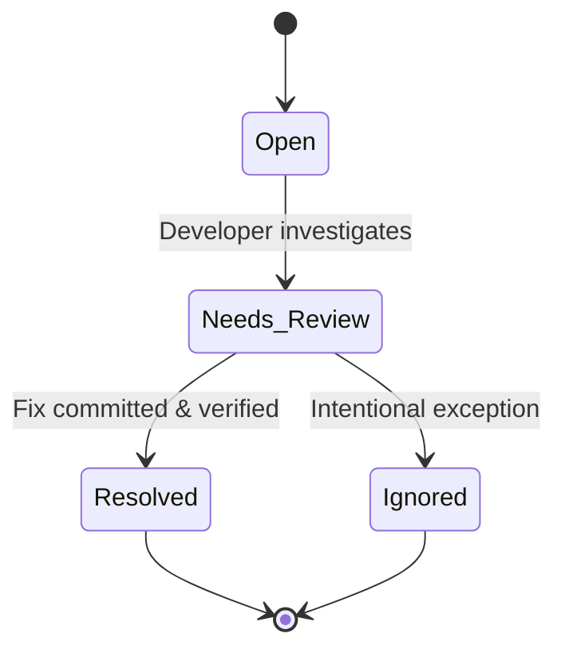

# Configuration Debt Tracker
### *Intelligent Configuration Debt Analysis and Remediation System*

[]()
[]()
[]()
[]()

> A deterministic, static-analysis-powered VS Code extension for identifying, auditing, prioritizing, and remediating configuration debt across multi-language, multi-format software repositories.

---

## Table of Contents
1. [Project Overview](#project-overview)
2. [Problem Statement & Motivation](#problem-statement--motivation)
3. [Software Configuration Management (SCM) Alignment](#software-configuration-management-scm-alignment)
4. [Architecture & System Pipeline](#architecture--system-pipeline)
5. [Core Modules](#core-modules)
6. [Debt Detection Methodology](#debt-detection-methodology)
7. [Explainable Risk Scoring Engine](#explainable-risk-scoring-engine)
8. [Configuration Health Score Calculation](#configuration-health-score-calculation)
9. [Cleanup Backlog & Status Lifecycle](#cleanup-backlog--status-lifecycle)
10. [Supported Formats & Source Languages](#supported-formats--source-languages)
11. [AI Explainer Layer & Security Privacy Safeguards](#ai-explainer-layer--security-privacy-safeguards)
12. [VS Code Integration & User Interface](#vs-code-integration--user-interface)
13. [Installation & Setup](#installation--setup)
14. [Testing & Quality Verification](#testing--quality-verification)
15. [Live Demonstration Guide](#live-demonstration-guide)
16. [Limitations & Future Roadmap](#limitations--future-roadmap)

---

## 1. Project Overview

Modern software repositories continuously accumulate configuration assets: `.env` files, YAML manifests, JSON properties, XML files, Dockerfiles, Docker Compose files, and Kubernetes declarations. While code is subject to continuous linting, code reviews, and dead-code elimination, **configuration is rarely audited**. 

Over time, this asymmetry produces **Configuration Debt**:
- Dead configuration settings that are no longer referenced by any application code.
- Duplicated configuration spread across container definitions, local `.env` files, and cloud manifests that silently drift.
- Forgotten feature flags lingering months after product launches.
- Unmasked plaintext credentials and API tokens committed directly into version control.
- Undocumented settings without ownership or clear semantic scope.

The **Configuration Debt Tracker** is an engineering diagnostic tool built as a **native VS Code extension**. It analyzes configuration assets and application source code together to deterministically answer:

> *"Which configuration in this repository is becoming unnecessary, risky, duplicated, stale, or difficult to maintain?"*

---

## 2. Problem Statement & Motivation

### The Configuration Debt Crisis
In microservice and cloud-native architectures, configuration drift and zombie configurations represent a major source of production outages:
1. **Cognitive Overhead**: Developers waste time investigating environment variables and configuration properties that haven't been used in years.
2. **Configuration Drift**: An environment variable like `API_TIMEOUT` is declared in `.env` (5000ms), `application.yml` (10000ms), and `docker-compose.yml` (5000ms). When modified in one place, services behave inconsistently between local, container, and cluster environments.
3. **Security Vulnerabilities**: High-entropy API tokens, database URIs with passwords, and private keys are frequently hardcoded or committed into configuration files without encryption.
4. **Architectural Fragility**: When feature flags are left behind, dead code branches persist in production, increasing maintenance risk.

Unlike conventional linters that only inspect isolated files for syntax errors, the **Configuration Debt Tracker** connects configuration declarations directly to source-code access patterns (`process.env`, `os.environ`, `@Value("${...}")`), synthesizing an accurate, cross-file debt audit.

---

## 3. Software Configuration Management (SCM) Alignment

This project is grounded in formal Software Configuration Management (SCM) principles (IEEE 828 standard) and maps directly to the four foundational pillars:

```
+-----------------------------------------------------------------------------------+
|                        SCM CORE PILLARS MAPPING                                   |
+-----------------------------------------------------------------------------------+
| 1. Configuration Identification   --> Automated Configuration Scanner & Inventory  |
| 2. Configuration Control          --> Prioritized Cleanup Backlog & Status Lifecycle|
| 3. Status Accounting              --> Configuration Health Score & Trend History   |
| 4. Configuration Audit            --> Static Usage Analysis & Debt Verification   |
+-----------------------------------------------------------------------------------+
```

### 1. Configuration Identification
The system scans the repository, identifies configuration baseline items across `.env`, YAML, JSON, XML, Dockerfile, Docker Compose, and Kubernetes manifests, and records a structured inventory with metadata, file paths, line numbers, formats, and sensitivity classifications.

### 2. Configuration Control
Identified configuration debts are organized into an actionable, prioritized **Cleanup Backlog**. Remediation actions follow a formal status transition lifecycle:
$$\text{Open} \longrightarrow \text{Needs Review} \longrightarrow \text{Resolved} \quad \text{or} \quad \text{Ignored}$$
User decisions are persisted locally in `.config-debt/backlog.json` and survive subsequent scans.

### 3. Status Accounting
Repository configuration health is quantified through a deterministic **Configuration Health Score** (0–100) paired with historical scan snapshots recorded in `.config-debt/history.json`. Historical trends communicate whether configuration health is improving or degrading over time.

### 4. Configuration Audit
The engine executes continuous static audits comparing declared configuration items with actual source-code usage. It calculates deterministic detection confidence and verifies that no orphan configuration assets drift from baseline standards.

---

## 4. Architecture & System Pipeline

The system follows an asynchronous, pipeline-driven architecture:

```mermaid
graph TD
    Workspace[Workspace Directory] --> Scanner[Module 1: Configuration Scanner]
    Scanner --> Inventory[Configuration Inventory]
    Inventory --> Analyzer[Module 2: Source Usage Analyzer]
    Analyzer --> UsageMap[Usage Reference Map]
    Inventory --> Detector[Module 3: Debt Detector]
    UsageMap --> Detector
    Detector --> Findings[Debt Findings]
    Findings --> RiskEngine[Module 4: Risk Engine]
    RiskEngine --> HealthCalc[Module 5: Health Score Calculator]
    HealthCalc --> HealthScore[Configuration Health Score]
    RiskEngine --> Backlog[Module 6: Cleanup Backlog]
    HealthScore --> History[Module 7: History Service]
    Backlog --> UI[Module 8: VS Code Webview Dashboard & Sidebar]
    Findings --> AI[AI Explainer Layer (Optional)]
```

---

## 5. Core Modules

| Module | Name | Responsibility | SCM Alignment |
|---|---|---|---|
| **Module 1** | **Configuration Scanner** | Recursively scans workspace files, ignores build artifacts (`node_modules`, `.git`, `dist`, `target`), dispatches files to format-specific adapters, and builds the configuration inventory. | Configuration Identification |
| **Module 2** | **Source Usage Analyzer** | Analyzes Python, JavaScript, TypeScript, and Java source files for configuration access patterns. Assigns confidence ratings to references. | Configuration Audit |
| **Module 3** | **Debt Detector** | Evaluates inventory against usage to detect dead, duplicated, stale, secret, and undocumented configurations. | Configuration Audit |
| **Module 4** | **Risk Engine** | Computes a transparent, 0–100 risk score for every finding using weighted age, usage, impact, and sensitivity factors. | Configuration Audit |
| **Module 5** | **Configuration Health Score** | Calculates a deterministic 0–100 health metric representing repository configuration hygiene. | Status Accounting |
| **Module 6** | **Cleanup Backlog** | Organizes findings into an actionable backlog with priority rankings and status tracking. | Configuration Control |
| **Module 7** | **Scan History & Trends** | Records scan snapshots to track improvements or degradation over time. | Status Accounting |
| **Module 8** | **VS Code Integration** | Provides Activity Bar views, command palette actions, text editor line navigation, and interactive webview dashboards. | Tooling Integration |
| **Module 9** | **AI Explainer Layer** | Generates natural-language remediation guidance with offline fallback and zero secret exposure. | Auxiliary Guidance |

---

## 6. Debt Detection Methodology

The Debt Detector operates on deterministic heuristics and strictly avoids guessing:

### A. Dead Configuration
* **Condition**: Configuration key is declared in a configuration file, but 0 references are detected across all workspace source files.
* **Confidence**: 95%–99%.
* **Evidence**: Exact count of scanned source files and confirmed absence of references.
* **Action**: Deprecate and remove obsolete key from configuration baseline.

### B. Duplicated Configuration & Drift
* **Condition**: The same logical key is declared across 2 or more distinct configuration files (e.g. `.env`, `application.yml`, and `docker-compose.yml`).
* **Drift Detection**: If values differ between files, the finding is flagged with **CONFIGURATION DRIFT**.
* **Confidence**: 96%.
* **Action**: Consolidate declarations into a single authoritative source of truth.

### C. Outdated / Stale Configuration
* **Condition**: Key name begins with or contains legacy indicators (`OLD_`, `LEGACY_`, `DEPRECATED_`, `TEMP_`, `V1_`) OR has remained unchanged for $>90$ days with 0/1 references.
* **Confidence**: 88%.
* **Action**: Decommission temporary feature flags and clean up conditional branches.

### D. Hardcoded Secrets
* **Condition**: Matched against known credential regex patterns (Stripe `sk_live_`, AWS `AKIA`, GitHub `ghp_`, Slack tokens, JWTs, database connection URIs with embedded passwords) or high Shannon entropy ($H > 4.2$).
* **Privacy Safeguard**: Values are **always masked** (`••••••••`) in logs, UI, and AI prompts.
* **Confidence**: 94%–99%.
* **Action**: Extract secrets to an external secrets vault or uncommitted local environment.

### E. Undocumented Configuration
* **Condition**: Configuration item lacks preceding or inline documentation comments in sensitive or actively used settings.
* **Confidence**: 90%.
* **Action**: Add explanatory comments specifying purpose, format, and ownership.

---

## 7. Explainable Risk Scoring Engine

Every finding receives a risk score from $0$ to $100$. The score is strictly deterministic and fully explainable.

### Mathematical Formulation

$$\text{Risk Score} = \left(\text{Age Score} \times 0.25\right) + \left(\text{Usage Score} \times 0.35\right) + \left(\text{Impact Score} \times 0.25\right) + \left(\text{Sensitivity Score} \times 0.15\right)$$

Where each factor is evaluated on a $0$–$100$ scale:
* **Age Factor (25% Weight)**: Evaluates configuration exposure or stagnation time.
  * Secrets: $>60$ days = 95 pts, $>14$ days = 80 pts.
  * Dead/Stale: $>180$ days = 95 pts, $>90$ days = 80 pts, $>30$ days = 55 pts.
* **Usage Factor (35% Weight)**: Evaluates runtime coupling and blast radius.
  * Dead Config: 0 usages = 95 pts (maximum debt).
  * Duplicated: $50 + (\text{files} \times 15)$ pts (sync risk).
  * Secret: Actively referenced in code = 90 pts.
* **Impact Factor (25% Weight)**: Evaluates systemic risk to production.
  * Plaintext secrets: 95 pts.
  * Active configuration drift: 88 pts.
  * Multiple affected files: $\min(90, 50 + \text{files} \times 10)$ pts.
* **Sensitivity Factor (15% Weight)**: Evaluates confidentiality risk.
  * `secret`: 100 pts.
  * `sensitive`: 75 pts.
  * `internal`: 40 pts.
  * `public`: 15 pts.

### Severity Classification

| Risk Score Range | Severity Level | UI Indicator | Action Required |
|---|---|---|---|
| **> 75** | **Critical** | Red (`#f14c4c`) | Immediate remediation (Secrets, severe drift) |
| **50 – 75** | **High** | Orange (`#e88500`) | Prioritize in current sprint (Dead keys, duplications) |
| **25 – 49** | **Medium** | Yellow (`#cca700`) | Review and schedule cleanup (Stale flags, undocumented) |
| **< 25** | **Low** | Blue (`#3794ff`) | Informational hygiene improvement |

---

## 8. Configuration Health Score Calculation

The repository health score provides a high-level status accounting metric:

$$\text{Health Score} = \max\left(0, \min\left(100, 100 - \sum \text{Deductions}\right)\right)$$

### Deductions Model

* **Critical Finding**: $-10$ points each (capped at $-45$ pts max).
* **High Finding**: $-5$ points each (capped at $-30$ pts max).
* **Medium Finding**: $-2$ points each (capped at $-15$ pts max).
* **Low Finding**: $-0.5$ points each (capped at $-10$ pts max).

### Health Grades
* **$80 - 100$**: **Healthy** (Low debt; high hygiene)
* **$65 - 79$**: **Moderate** (Actionable debt items present)
* **$45 - 64$**: **Degraded** (Significant dead configuration or drift)
* **$< 45$**: **Critical** (Hardcoded secrets, severe drift, or abandoned configurations)

---

## 9. Cleanup Backlog & Status Lifecycle

The **Cleanup Backlog** translates static findings into an actionable engineering task list.



* **Open**: Default state for all newly detected findings.
* **Needs Review**: Marked when cross-team confirmation is required.
* **Resolved**: Set when obsolete configuration is removed or secrets are migrated.
* **Ignored**: Suppresses finding when a key is intentionally kept for future external integrations.

---

## 10. Supported Formats & Source Languages

### Configuration Formats
* **Environment Files**: `.env`, `.env.*`, `*.env`
* **YAML**: `.yaml`, `.yml` (Hierarchical properties, comments, AST line positioning)
* **JSON**: `.json` (Object trees, dot-notation flattening, exact line tracking)
* **XML**: `.xml` (Spring `applicationContext.xml`, Maven `pom.xml`, Android `AndroidManifest.xml`)
* **Docker**: `Dockerfile`, `*.dockerfile` (`ENV`, `ARG` directives)
* **Docker Compose**: `docker-compose.yml`, `compose.yaml` (Service environment arrays and maps)
* **Kubernetes**: ConfigMaps, Secrets, Deployment/Pod container `env` definitions

### Source Code Languages
* **Python** (`.py`):
  * `os.environ["KEY"]`, `os.environ.get("KEY")`
  * `os.getenv("KEY")`
  * `settings.KEY`, `env("KEY")`, `config("KEY")`
* **JavaScript / TypeScript** (`.js`, `.jsx`, `.ts`, `.tsx`, `.mjs`):
  * `process.env.KEY`, `process.env['KEY']`
  * `import.meta.env.KEY`
  * `config.get('KEY')`
* **Java** (`.java`):
  * Spring `@Value("${key}")`, `@Value("${key:default}")`
  * `System.getenv("KEY")`
  * `System.getProperty("key")`
  * `@ConfigProperty(name = "key")`
* **Generic Fallback**:
  * Shell scripts (`.sh`, `.bash`, `.ps1`), Go (`.go`), Rust (`.rs`), Ruby (`.rb`)
  * Normalized key search (`DATABASE_URL` $\leftrightarrow$ `database.url` $\leftrightarrow$ `databaseUrl`)

---

## 11. AI Explainer Layer & Security Privacy Safeguards

The AI Explainer is strictly an **optional explanation layer**. Core detection and risk scoring are 100% deterministic.

### Privacy & Zero-Leakage Guarantee
* **Never Transmits Raw Secrets**: Any secret or sensitive credential is redacted and masked prior to prompt construction.
* **Metadata Only**: Only the key name, debt category, risk factors, line number, and evidence summary are communicated.
* **Offline Deterministic Fallback**: If an API key is not configured or network access is unavailable, the extension automatically switches to the built-in **Deterministic SCM Explainer Engine**, ensuring full offline operation.

---

## 12. VS Code Integration & User Interface

Designed following professional developer tooling aesthetics (VS Code, Linear, Sentry, Datadog):
* **No generic AI card soup, no glowing purple blobs, no decorative gradients.**
* **Native VS Code Theme Integration**: Adapts seamlessly to Dark, Light, High Contrast, and custom developer color themes using official `var(--vscode-...)` CSS tokens.
* **Direct Navigation**: Clicking any file location link jumps directly to the target file and highlights the exact line.
* **Information Density**: Compact data tables, keyboard-friendly navigation, and clear visual hierarchy.

### Registered VS Code Commands
* `Configuration Debt: Scan Workspace` (`configDebt.scanWorkspace`)
* `Configuration Debt: Open Main Dashboard` (`configDebt.openDashboard`)
* `Configuration Debt: Show Cleanup Backlog` (`configDebt.showBacklog`)
* `Configuration Debt: Refresh Analysis` (`configDebt.refreshAnalysis`)
* `Configuration Debt: Clear Scan History` (`configDebt.clearHistory`)
* `Configuration Debt: Explain Finding` (`configDebt.explainFinding`)

---

## 13. Installation & Setup

### Prerequisites
* [Visual Studio Code](https://code.visualstudio.com/) version 1.85.0 or higher.
* [Node.js](https://nodejs.org/) v18.0.0 or higher.
* `npm` v9.0.0 or higher.

### Local Build & Installation
```bash
# Clone the repository
git clone https://github.com/srihareeshh/Configuration-Debt-Tracker.git
cd Configuration-Debt-Tracker

# Install dependencies
npm install

# Compile TypeScript extension
npm run compile
```

To run in VS Code Extension Development Host:
1. Open the project folder in VS Code.
2. Press `F5` (or select **Run > Start Debugging**).
3. A new Extension Development Host window will launch with Configuration Debt Tracker activated.

---

## 14. Testing & Quality Verification

The project includes an extensive automated test suite covering all modules:

```bash
# Run full automated test suite
npm test
```

### Test Suite Coverage
1. **Configuration Parsers**: `.env`, YAML, JSON, XML, Dockerfile, Docker Compose, Kubernetes manifests.
2. **Source Usage Analyzers**: Python (`os.environ`, `os.getenv`), JS/TS (`process.env`), Java (`@Value`, `System.getenv`).
3. **Debt Detector**: Used vs. unused detection, multi-file duplication, configuration drift, hardcoded secret heuristics, stale flags, and undocumented settings.
4. **Risk Scoring Engine**: Deterministic weighted formula calculation, explainability factors, and severity thresholds.
5. **Configuration Health Score**: Deductions model, score bounding, and grade classification.
6. **Services**: Cleanup backlog status lifecycle and scan history tracking.
7. **Pipeline Resilience**: Empty workspace handling and graceful recovery from malformed YAML/JSON.

---

## 15. Live Demonstration Guide

A realistic microservice repository fixture is provided in `sample-repo/` containing intentionally planted configuration debt:
* `sample-repo/.env`: Contains active `DATABASE_URL`, unused `OLD_API_URL`, plaintext `API_KEY`, and temporary `FEATURE_LEGACY_LOGIN`.
* `sample-repo/application.yml`: Contains duplicated `api.timeout` with **value drift** ($10000$ms vs. $5000$ms) and undocumented `cache.ttl`.
* `sample-repo/docker-compose.yml`: Duplicated environment variables across containers.
* `sample-repo/src/`: Multi-language source references across TypeScript (`config.ts`, `db.ts`, `legacy.ts`), Java (`ServiceApp.java`), and Python (`worker.py`).

### Running the Live Demonstration
```bash
npm run demo
```

This runs the automated terminal audit across all 5 SCM pillars and outputs:
1. Complete configuration inventory.
2. Source reference trace map with confidence levels.
3. Prioritized findings with deterministic risk breakdown.
4. Overall health score with itemized deductions.
5. Actionable cleanup backlog.
6. AI explanation sample.

---

## 16. Limitations & Future Roadmap

### Known Limitations
* **Dynamic Computed Keys**: Highly dynamic configuration keys (e.g. `process.env['PREFIX_' + dynamicVar]`) are detected with moderate confidence ($60\%$) rather than exact confidence.
* **Pre-compiled Binaries**: Analyzes human-readable source code; does not decompile `.class` or binary executable files.

### Future Roadmap
* Git Blame / Commit Author Integration: Correlate oldest unreferenced configurations with commit authors for automated team assignment.
* CI/CD Quality Gate Action: Standalone GitHub Action to fail pull requests if configuration health score drops below a configured threshold.
* Automated Pull Request Generation: One-click remediation to comment out or delete confirmed dead configurations.

---

## License
MIT License. Developed for academic Software Configuration Management curriculum evaluation.
