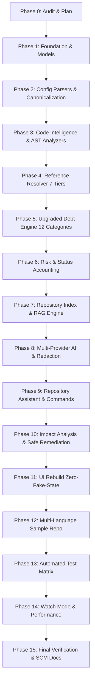

# Configuration Debt Tracker — Master Rebuild Plan

**Project:** Configuration Debt Tracker (Intelligent Configuration Debt Analysis and Remediation System)  
**Document:** Master Engineering Rebuild & Implementation Roadmap  
**Status:** Approved for Phased Execution  

---

## 1. Overview & Architectural Principles

This document defines the 15-phase implementation plan to upgrade the Configuration Debt Tracker into a professional, repository-aware code intelligence tool.

### Core Non-Negotiable Rules
1. **Single Application:** A single VS Code extension. No separate SaaS web apps, no custom IDE fork.
2. **Deterministic Layer A:** All configuration discovery, AST reference detection, debt classification, risk scoring, and health metrics are 100% deterministic, explainable, and reproducible without AI.
3. **Repository-Aware Layer B:** AI assistant operates strictly over a structured repository index and targeted context retrieval (RAG). It provides natural-language reasoning, answers cross-file queries, maps dependency impact, and suggests remediation diffs with zero hallucination.
4. **Zero Secret Leakage:** All credentials and secrets are detected and redacted (`<REDACTED>`) before entering UI views, logs, or AI context prompts.
5. **Zero Fake UI Defaults:** No hardcoded mock values (e.g., Health 82, 3 Critical, 74 items). When no scan exists, the UI renders a genuine unanalyzed state.
6. **Mathematical SCM Integrity:** Inventory used/unused counts are derived from actual verified references, eliminating finding-subtraction flaws.
7. **Multi-Language AST/Structural Analysis:** Replaces naive regex searches with an AST/token-aware parser architecture supporting JavaScript, TypeScript, TSX, Python, Java, Go, Rust, C, C++, C#, PHP, Ruby, Kotlin, Shell, PowerShell, and Generic structural fallback.

---

## 2. Phased Implementation Roadmap

---

## 3. Detailed Phase Breakdown

### Phase 1: Foundation & Data Model Upgrades
- Update `src/models/finding.ts`:
  - Expand `DebtCategory` to 12 categories: `dead_configuration`, `duplicated_configuration`, `configuration_drift`, `stale_configuration`, `hardcoded_secret`, `undocumented_configuration`, `suspicious_dynamic_reference`, `environment_inconsistency`, `unused_feature_flag`, `high_impact_configuration`, `test_only_configuration`, `weak_evidence_configuration`.
- Update `src/models/usage.ts`:
  - Add 7 confidence tiers: Level 1 (Static Prop 98–100%), Level 2 (Index Access 97–99%), Level 3 (Framework Helper 90–98%), Level 4 (Normalized Key 70–90%), Level 5 (Dataflow/Propagation 70–85%), Level 6 (Dynamic Construction 50–70%), Level 7 (Generic Text Match 40–60%).
  - Add AST symbol metadata (`SymbolInfo`: name, kind, container, startLine, endLine).
- Update `src/models/scan.ts`:
  - Fix inventory definition: calculate `usedItems` from verified referenced items directly.
  - Add models for `ImpactAnalysisResult` (affected files, symbols, dependency callers, risk level).
  - Add models for `RemediationProposal` (proposed diff patch, explanation, confirmation status).

### Phase 2: Configuration Parsers & Canonicalization Engine
- Expand configuration formats in `src/parsers/`:
  - Add `toml/tomlParser.ts` for `.toml`, `pyproject.toml`, `Cargo.toml`.
  - Add `properties/propertiesParser.ts` for `.properties`, `.ini`, Spring `application.properties`, Gradle `gradle.properties`.
  - Register all in `parserRegistry.ts`.
- Implement `src/code-intelligence/references/normalizedKeyResolver.ts`:
  - `canonicalizeKey(key: string): string`
  - `generatePossibleVariants(key: string): string[]`
  - `compareLogicalKeys(keyA: string, keyB: string): { related: boolean; confidence: number; reason: string }`
  - `explainKeyRelationship(keyA: string, keyB: string): string`

### Phase 3: Code Intelligence & Language/AST Architecture
- Establish `src/code-intelligence/`:
  - `parser/parserManager.ts`: Central syntax coordinator and dispatcher.
  - `parser/languageDetector.ts`: Extension and shebang-based language detection.
  - `parser/parserCache.ts`: In-memory parsed tree and token caching.
  - `ast/astIndexer.ts`: Indexes AST nodes and tokens.
  - `ast/symbolExtractor.ts`: Extracts functions, classes, methods, and enclosing scopes.
  - `ast/importExtractor.ts`: Extracts module imports and aliases.
  - `ast/stringExtractor.ts`: Isolates string literals and distinguishes them from comments.
  - `languages/`: Specialized language analyzers implementing `LanguageAnalyzer` interface:
    - `javascript/`, `typescript/`, `python/`, `java/`, `go/`, `rust/`, `c/`, `cpp/`, `csharp/`, `php/`, `ruby/`, `kotlin/`, `shell/`, `generic/`.
- False Positive Protection:
  - Comments (line `//`, block `/* */`, hash `#`, docstrings) are strictly excluded from usage counts.
  - Plain string documentation without configuration access context is classified as documentation or generic fallback, never exact usage.

### Phase 4: Reference Resolver & 7-Level Confidence Engine
- Implement `src/code-intelligence/references/referenceResolver.ts`:
  - Resolves references with calibrated confidence levels (Levels 1–7).
  - Integrates `configAccessPatterns.ts` defining language-specific environment access patterns (`process.env`, `os.getenv`, `System.getenv`, `@Value`, `std::env::var`, `os.Getenv`, `Environment.GetEnvironmentVariable`, etc.).
  - Resolves local constant propagation (Level 5) and dynamic string concatenation (Level 6).

### Phase 5: Upgraded Debt Engine (12 Categories)
- Refactor `src/core/detector/debtDetector.ts`:
  - Split duplication into logical duplicate vs. active configuration drift.
  - Identify stale feature flags via conditional branch inspection (`FEATURE_*`, `ENABLE_*`, `LEGACY_*` in conditional statements).
  - Detect suspicious dynamic references (`process.env[prefix + ...]`).
  - Detect test-only configuration (referenced solely inside test directories/files).
  - Detect high-impact configuration (widely referenced across multiple core modules).
  - Flag configuration with weak evidence (only matched via generic Level 7 text match).

### Phase 6: Risk & Status Accounting Engine
- Retain the proven academic risk formula:
  $$\text{Risk Score} = (\text{Age} \times 0.25) + (\text{Usage} \times 0.35) + (\text{Impact} \times 0.25) + (\text{Sensitivity} \times 0.15)$$
- Provide transparent sub-factor breakdowns:
  - Age Factor: $0 - 25$ pts
  - Usage Factor: $0 - 35$ pts
  - Impact Factor: $0 - 25$ pts
  - Sensitivity Factor: $0 - 15$ pts
- Status Accounting: Compute mathematically exact health scores ($100 - \text{deductions}$) and track chronological snapshot deltas.

### Phase 7: Repository Knowledge Index & RAG Engine
- Implement `src/code-intelligence/index/repositoryIndex.ts`:
  - Structured storage for: indexed files, symbols, configuration declarations, source references, caller relationships, findings.
- Implement `src/code-intelligence/retrieval/retrievalEngine.ts`:
  - Target query parser: extracts referenced configuration keys, file paths, symbols.
  - Evidence context builder: gathers only relevant code snippets with line numbers, enclosing function signatures, and configuration findings.
  - Secret sanitizer: redacts all credential values before context handoff.

### Phase 8: Multi-Provider AI Architecture & Safety Redaction
- Implement provider abstraction in `src/ai/`:
  - `aiProvider.ts`: `IAIProvider` interface (`id`, `name`, `isAvailable()`, `chat()`).
  - `localProvider.ts`: Connects to local OpenAI-compatible runtimes (Ollama, LM Studio on `http://localhost:11434` or configured endpoint).
  - `geminiProvider.ts`: Connects to Google Gemini API using native fetch.
  - `openAICompatibleProvider.ts`: Connects to OpenAI-compatible cloud endpoints.
  - `offlineProvider.ts`: Deterministic, rule-based reasoning engine operating 100% offline.
  - `aiProviderFactory.ts`: Dispatches to active provider based on configuration.
  - `contextBuilder.ts`: Builds compact, token-efficient, redacted RAG prompts.
  - `promptBuilder.ts`: Formats strict SCM instructions and hallucination constraints.

### Phase 9: Repository-Aware Assistant & Interactive Commands
- Register commands in `src/extension.ts`:
  - `Configuration Debt: Ask Repository Assistant`
  - `Configuration Debt: Explain Finding`
  - `Configuration Debt: Explain Selection`
  - `Configuration Debt: Assess Removal Impact`
  - `Configuration Debt: Test AI Connection`
  - `Configuration Debt: Watch Workspace`
  - `Configuration Debt: Rebuild Code Index`
- Connect assistant to the Sidebar and Dashboard query panels with clickable file/line navigation.

### Phase 10: Code Impact Analysis & Safe Remediation
- Implement `src/core/impact/impactAnalyzer.ts`:
  - "What breaks if I delete this?": Declaration $\to$ References $\to$ Enclosing Functions $\to$ Modules $\to$ Dependent Files.
  - Produces Static Dependency Evidence with confidence ratings and blind-spot advisories.
- Implement `src/services/remediationService.ts`:
  - [Prepare Remediation]: Computes unified diff patch for obsolete declarations.
  - [Apply Patch]: Requires explicit user confirmation dialog before disk modification.

### Phase 11: UI Rebuild (Zero Fake Defaults & Developer Aesthetics)
- Refactor `src/ui/sidebarProvider.ts` and `src/ui/dashboardHtml.ts`:
  - Remove all hardcoded prototype defaults (`82`, `3 crit`, `74 total`).
  - Render genuine clean empty state with prominent "Scan Workspace" action.
  - Add live search, severity filters, category filters, and detail drawer with evidence breakdown.
  - Add "Assess Removal Impact" and "Ask AI" buttons on each finding card.
  - Maintain clean VS Code theme tokens (`var(--vscode-...)`), monospace paths/keys, and zero SaaS purple gradients or glassmorphism.

### Phase 12: Multi-Language Demonstration Repository
- Expand `sample-repo/`:
  - Add `src/go/worker.go`, `src/rust/config.rs`, `src/csharp/Settings.cs`, `src/shell/deploy.sh`.
  - Include Kubernetes manifests (`k8s/deployment.yaml`, `k8s/configmap.yaml`, `k8s/secret.yaml`).
  - Plant deliberate debt: dead configs (`OLD_API_URL`), active drift (`API_TIMEOUT=5000` vs `10000`), feature flags (`FEATURE_LEGACY_LOGIN`), hardcoded secrets (`API_KEY`), and undocumented keys (`CACHE_TTL`).
- Update `scripts/demonstrate.ts` to execute a comprehensive, polished terminal demonstration across all 5 SCM pillars + AST intelligence + AI assistant.

### Phase 13: Automated Test Matrix
- Expand test suite in `tests/`:
  - `parsers/`: Env, YAML, JSON, XML, Docker, K8s, TOML, Properties.
  - `analyzers/`: Multi-language AST analyzers (JS, TS, Python, Java, Go, Rust, C#, Shell).
  - `false_positives/`: Test comments, docstrings, variable assignments are rejected as real usages.
  - `confidence/`: Test Level 1 through Level 7 confidence ratings.
  - `canonical/`: Test key variants and relationship explanation.
  - `detector/`: Test all 12 debt categories.
  - `risk/` & `health/`: Test math, deductions, and score bounds.
  - `ai/`: Test context builder, secret redaction, provider fallback, and offline reasoning.
  - `pipeline/`: Full end-to-end scan pipeline.

### Phase 14: Watch Mode, File Safety & Performance
- Add debounced workspace watcher (`vscode.workspace.onDidChangeTextDocument`, `onDidCreateFiles`, `onDidDeleteFiles`).
- Add file size guards (skip files $> 2\,\text{MB}$, skip binary files).
- Implement parser caching for incremental re-scans.

### Phase 15: Final Verification, SCM Documentation & Git Integration
- Update `README.md` to comprehensively document the upgraded architecture, AST analysis, 12 debt categories, RAG assistant, and SCM academic defense.
- Verify TypeScript compilation (`npm run compile`).
- Verify test suite (`npm test`).
- Verify demonstration script (`npm run demo`).
- Commit and push to GitHub repository.

---

## 4. Phase Verification Protocol

After completing each phase:
1. `npm run compile`: Verify TypeScript compiler produces 0 errors.
2. `npm test`: Verify 100% test pass rate.
3. Review git status and inspect changed files.
4. Only advance to the next phase upon verified success.
